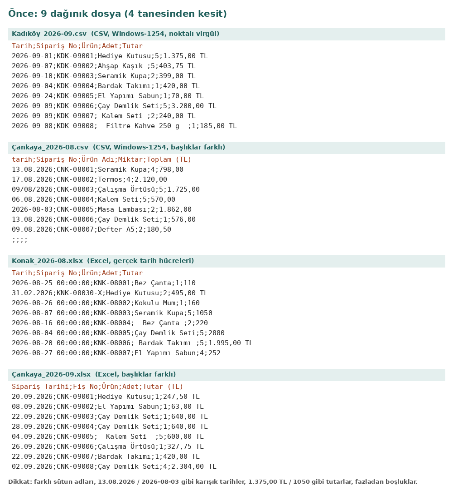
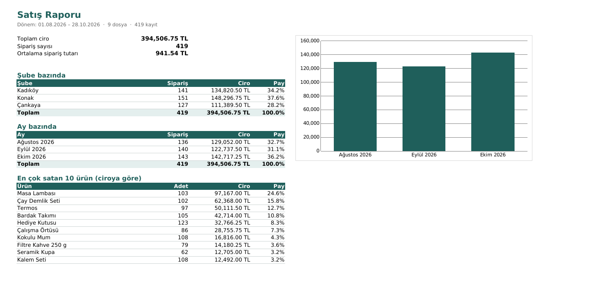

# Excel Rapor Otomasyonu

Her ay şubelerden gelen onlarca dağınık satış dosyasını (CSV ve Excel) elle birleştirmek yerine, tek komutla birleştirip temizleyen ve okunaklı bir Excel raporuna çeviren küçük bir Python aracı.
Farklı sütun adlarını, karışık tarih ve tutar yazımlarını, yinelenen ve bozuk satırları kendisi halleder. Silinen hiçbir şey kaybolmaz: atılan her satır, nedeniyle birlikte raporda ayrı bir sayfada durur.

## Önce / Sonra

**Önce:** 3 şube x 3 ay = 9 ayrı dosya; bir kısmı CSV, bir kısmı Excel; sütun adları, tarih ve tutar yazımları dosyadan dosyaya farklı.



*Temsilî görüntü: örnek dosyaların gerçek içeriği, tablo olarak çizilmiştir (ekran görüntüsü değildir).*

**Sonra:** tek bir Excel dosyası. Özet sayfası aşağıda; ayrıca "Aylık" (şube x ay tablosu), "Tüm Kayıtlar" (filtrelenebilir temiz veri) ve "Atılan Satırlar" sayfaları var.



*Üretilen raporun Özet sayfasının LibreOffice ile alınmış görüntüsüdür. Raporun kendisi: [`docs/ornek-rapor.xlsx`](docs/ornek-rapor.xlsx).*

## Kurulum ve çalıştırma

Python 3.8 veya üstü gerekir.

```bash
git clone https://github.com/caniyli/excel-rapor-otomasyonu.git && cd excel-rapor-otomasyonu
python3 -m venv .venv && source .venv/bin/activate    # Windows: .venv\Scripts\activate
pip install -r requirements.txt
python -m rapor ornek_veri/ --cikti rapor.xlsx
```

Çıktı şuna benzer:

```
Rapor hazır.
  Okunan dosya     : 9
  Birleşen satır   : 419
  Ayıklanan satır  : 24 (yinelenen: 13, bozuk/boş: 11)
  Toplam ciro      : 394.506,75 TL
  Çıktı            : rapor.xlsx
```

Ne yapar:

- Klasördeki tüm `.csv` ve `.xlsx` dosyalarını okur. CSV'de kodlama (UTF-8 / Windows-1254) ve ayraç (`;` `,` sekme `|`) otomatik algılanır. Excel dosyalarında ilk sayfa okunur.
- Sütun adlarını ortak alanlara eşler, tarihleri (`24.11.2026`, `2026-11-24`, `24/11/2026`) ve tutarları (`1.234,50`, `1234,5`, `1.250,00 TL`) normalleştirir, ürün adlarındaki fazla boşlukları temizler.
- Bozuk satırları (boş, tarihi/tutarı okunamayan, ürünü boş, adedi veya tutarı geçersiz) ve yinelenenleri ayıklar; hepsini nedeniyle "Atılan Satırlar" sayfasına yazar.
- Yinelenen: şube, tarih, sipariş no, ürün, adet ve tutarın hepsi aynı olan satırdır (dosyalar arasında da aranır).
- Şube adı, dosya adındaki ilk `_` öncesinden alınır (`Kadıköy_2026-08.csv` -> `Kadıköy`). Dosyada "Şube" sütunu varsa o kullanılır.
- Hata durumunda anlaşılır mesaj verir (klasör yok, hangi dosyada hangi sütun tanınmadı, çıktı dosyası Excel'de açık, vb.).

## Kendi dosyalarınıza uyarlama

Dosyalarınızdaki sütun başlıkları farklıysa [`rapor/sutun_eslemesi.json`](rapor/sutun_eslemesi.json) dosyasında ilgili listeye ekleyin; kod değiştirmek gerekmez:

```json
"tutar": ["Tutar", "Toplam", "Toplam (TL)", "Satış Tutarı", "Kazanç"]
```

- Zorunlu alanlar: `tarih`, `urun`, `tutar`. İsteğe bağlı: `adet` (yoksa 1 kabul edilir), `siparis_no`, `sube`.
- Büyük/küçük harf, Türkçe karakter ve fazla boşluk önemsizdir.
- Zorunlu bir sütun bulunamazsa araç dosya adını ve dosyadaki sütunları yazarak durur. Listede olmayan fazladan sütunlar uyarıyla yok sayılır.
- Başka bir eşleme dosyası için: `--esleme dosyam.json`.

Sınırlar (bilerek basit tutuldu): iki haneli yıllar (`24.11.26`) okunmaz; noktalı/eğik çizgili tarihler gün-ay-yıl sırasıyla okunur; `1,234` gibi tek virgüllü değer 1,234 (ondalık) sayılır; `.xls` desteklenmez; sıfır veya negatif tutarlı satırlar (iade vb.) bozuk sayılıp atılır.

## Testler

```bash
python -m pytest
```

Sütun eşleme, Türkçe sayı/tarih ayrıştırma, yinelenen ayıklama, kodlama/ayraç algılama ve uçtan uca test içerir. Uçtan uca test örnek veriyi yeniden üretir, rapor oluşturur ve toplamları üreticinin bildiği doğru değerlerle (toplam, şube, ay, satır ve atılan satır sayıları) karşılaştırır.

## Örnek veri uydurmadır

`ornek_veri/` altındaki dosyalar `ornek_veri_uret.py` ile, sabit tohumla (tekrarlanabilir) üretilmiş tamamen uydurma verilerdir; gerçek şirket, kişi veya marka içermez. Yeniden üretmek için: `python ornek_veri_uret.py`. Üretici, doğru toplamları `ornek_veri/beklenen.json` dosyasına da yazar.

## Dizin yapısı

```
rapor/                 aracın kodu (okuma, eşleme, ayrıştırma, temizleme, yazma, cli)
rapor/sutun_eslemesi.json   sütun eşleme tablosu
ornek_veri/            uydurma örnek dosyalar (+ beklenen.json)
ornek_veri_uret.py     örnek veri üreticisi
tests/                 pytest testleri
docs/                  README görselleri ve örnek rapor
```

## Lisans

MIT, bkz. [LICENSE](LICENSE). Telif: Mert Can Iyli.
